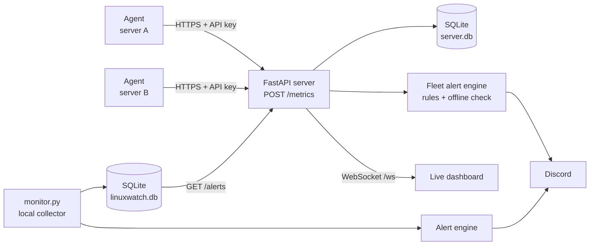

# LinuxWatch

A self-hosted Linux server monitoring system. Lightweight Python agents collect system metrics on each machine and send them to a central FastAPI server, which stores the history, fires smart alerts, and serves a live dashboard.


---

## Features

**Metrics** (collected every 60 s, configurable)
- CPU (total and per core), load average (1 / 5 / 15 min)
- RAM, swap, disk usage
- Disk read/write speed, network in/out and speed
- Top 5 processes by CPU and RAM
- CPU temperature (where sensors exist)
- Open TCP connections
- Service status (e.g. `sshd`, `cron`, `nginx`)
- Failed SSH login attempts per minute, parsed from the auth log

**Alert engine**
- Duration rules: alert only when a metric stays over its limit (default 5 min), so short spikes don't page anyone
- Cooldown: one alert per problem, then quiet (default 30 min)
- Automatic recovery detection with `RESOLVED` messages
- Discord webhook notifications
- Full alert history (fired time, resolved time, values) stored in SQLite
- **Fleet alerts:** the server checks every agent's readings, so alerts work for every node, not only the server box
- **Node offline alerts** when an agent stops reporting
- **Editable rules** from the dashboard: metric, limit, wait time, level, and all nodes or one node (optional admin token)

**Distributed architecture**
- Agent / server split: one agent per machine, one central API
- Per-agent API-key authentication
- Agents buffer readings locally when the server is down and resend them on reconnect, so no data is lost

**Live dashboard**
- Real-time updates over WebSockets (falls back to polling)
- Server-rack sidebar: every node is a rack unit with status LEDs for up, CPU, RAM and disk
- Fleet overview: KPIs, a card per node with CPU / RAM / disk bars and a CPU sparkline, latest alerts
- **Node detail page** (`#/node/<name>`): OS, kernel, uptime, memory and disk sizes, CPU gauge, CPU history, network, per-core CPU, top processes, services, load, temperature, connections, failed SSH logins, disk forecast and the node's own alerts
- Problem banner that names the node and problem needing attention
- Alert history with node and open / resolved filters
- Alert rules editor
- Time ranges: 15 min, 1 h, 6 h, 24 h, 7 d, 30 d
- Keyboard shortcuts: `1` / `2` / `3` switch pages, `j` / `k` move between nodes, `/` filters, `Esc` goes back

**Engineering**
- All thresholds, intervals, paths and services in one config file, no code edits needed
- Structured logging to a rotating log file (1 MB × 3)
- First-run permission check with a consent prompt for reading auth logs

---

## Architecture



| Component | File | Role |
| --- | --- | --- |
| Local collector | `monitor.py` | Collects the full metric set, saves to `linuxwatch.db`, runs alerts |
| Alert engine | `alerts.py` | Duration, cooldown, Discord, fired/resolved history |
| SSH watcher | `ssh_watch.py` | Counts failed SSH logins from `/var/log/auth.log` or `/var/log/secure` |
| Agent | `agent.py` | Sends readings to the central server, buffers when offline |
| Node details | `details.py` | Agent-side snapshot: OS, per-core CPU, top processes, services, temperature, SSH fails |
| Fleet alerts | `fleet_alerts.py` | Server-side rules for every node, offline detection, `/rules` API |
| Server | `server.py` | FastAPI: receives metrics, serves the API, WebSocket and dashboard |
| Dashboard | `dashboard.html` | Single-page live dashboard, no build step |
| Config | `config.ini` / `config.py` | All settings in one place, safe defaults |
| Logging | `log_setup.py` | Screen + rotating file logs |
| Schema | `schema.sql` | Tables for the local collector |
| Storage / detection | `storage.py`, `detect.py` | Retention + hourly rollups + Prometheus; anomaly and disk forecast routes |
| DB helper | `db.py` | Per-thread cached SQLite connections (WAL), server schema |

---

## Quick start

Tested on Ubuntu 24.04 with Python 3.12.

```bash
git clone https://github.com/[YOUR-USERNAME]/linuxwatch.git
cd linuxwatch
bash setup.sh                     # creates venv, installs packages, prints 2 API keys
cp config.example.ini config.ini  # then paste your keys into config.ini
```

Start the server:

```bash
./venv/bin/uvicorn server:app --host 0.0.0.0 --port 8000
```

Start an agent (on each machine to monitor):

```bash
./venv/bin/python agent.py
```

Start the local collector and alert engine:

```bash
./venv/bin/python monitor.py
```

Open the dashboard at **http://localhost:8000**.

---

## Configuration

Everything lives in `config.ini`:

```ini
[thresholds]
cpu_warning = 80
cpu_critical = 95
ram_warning = 85
disk_warning = 90

[monitor]
interval = 60
services = sshd, cron, nginx

[alerts]
duration = 300      ; seconds over the limit before alerting
cooldown = 1800     ; seconds of quiet after an alert

[discord]
webhook_url =       ; leave blank to disable

[dashboard]
admin_token =       ; set before going public; needed to edit alert rules

[agent]
server_url = http://localhost:8000
api_key = <key from setup.sh>

[api_keys]
<key 1> = linux-monitor
<key 2> = web-01
```

Each key in `[api_keys]` belongs to one host. The server rejects unknown keys with `401`.

On first start the server copies the `[thresholds]` and `[alerts] duration` values into alert rules (plus an "offline for 3 intervals" rule). After that, rules are edited on the dashboard's Alert rules page.

---

## API

| Method | Endpoint | Description |
| --- | --- | --- |
| `GET` | `/` | Dashboard |
| `GET` | `/health` | Server status |
| `POST` | `/metrics` | Agent sends a reading (header `X-API-Key`) |
| `POST` | `/metrics/batch` | Agent resends buffered readings, up to 1000 per request |
| `GET` | `/hosts` | Every host with up/down status and latest values |
| `GET` | `/metrics?host=&minutes=` | History for one host |
| `GET` | `/hosts/{host}/details` | Latest snapshot: OS, cores, processes, services, temperature |
| `GET` | `/alerts?limit=&host=` | Alert history, every node |
| `GET` | `/rules` | Alert rules |
| `POST` / `PUT` / `DELETE` | `/rules`, `/rules/{id}` | Add, change, remove a rule (header `X-Admin-Token` when set) |
| `GET` | `/history?host=&days=` | Hourly rollups for one host |
| `GET` | `/prometheus` | Prometheus text metrics |
| `GET` | `/anomalies?host=&minutes=` | Rolling z-score anomalies for one host |
| `GET` | `/anomalies/now` | Anomalies in the latest reading, all hosts |
| `GET` | `/forecast` | Disk-full forecast per host |
| `WS` | `/ws` | Live host list, pushed every 5 s |

Interactive API docs: **http://localhost:8000/docs**

---

## Tech stack

Python · psutil · FastAPI · Uvicorn · WebSockets · SQLite · Twisted · Discord webhooks · vanilla JavaScript + SVG

---

## Security notes

- `config.ini` holds API keys and the Discord webhook URL. It is listed in `.gitignore` and never committed; `config.example.ini` shows the format with fake values.
- Generate fresh keys with `bash setup.sh` before deploying anywhere reachable from the internet.
- Reading auth logs needs the `adm` group. On first run LinuxWatch asks before changing permissions; without permission it skips SSH tracking and keeps everything else running.

---

## Roadmap

- [x] Core collector and SQLite storage
- [x] Extended metrics (per-core CPU, load, swap, disk I/O, processes, temperature, connections, services, SSH logins)
- [x] Config file and rotating logs
- [x] Alert engine with duration, cooldown, Discord and history
- [x] Agent / server split with API keys and offline buffering
- [x] Live web dashboard over WebSockets
- [ ] PostgreSQL / TimescaleDB, data retention and downsampling
- [ ] Anomaly detection (rolling mean and standard deviation) and disk-full forecasting
- [ ] Docker, systemd unit, AWS EC2 deployment with a public demo
- [ ] pytest suite and GitHub Actions CI

---

## Author

Chaunte Sterling · [GitHub](https://github.com/[YOUR-USERNAME]) · [LinkedIn](https://linkedin.com/in/[YOUR-PROFILE])
